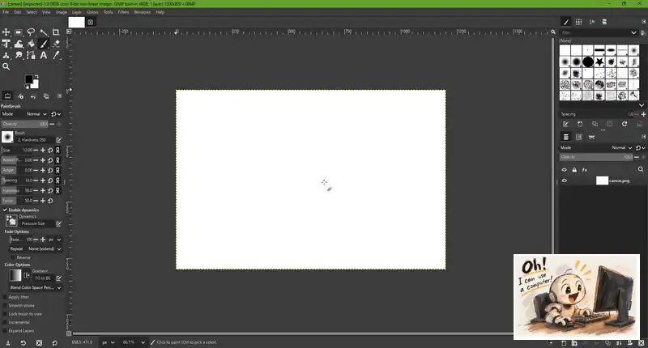

<p align="center">
  
</p>

<h1 align="center">Pi Agent Computer Use</h1>

<p align="center">Lets your Pi agent use Windows apps and browsers: it reads the window, clicks, types, draws and checks what happened.</p>

<div align="center">

[](https://www.npmjs.com/package/pi-agent-computer-use)
[](https://www.npmjs.com/package/pi-agent-computer-use)
[](https://github.com/alexshpunt/pi-agent-computer-use/actions/workflows/ci.yml)
[](./LICENSE)

</div>

<div align="center">

[](https://pi.dev/packages/pi-agent-computer-use)
[](https://github.com/alexshpunt/pi-agent-ide)
[](#platforms)

</div>

Ask your agent to do something on your computer, for example "open Paint and draw a house", "fill in this form in my browser" or "check what the settings window says". It finds the window, reads its controls and screenshot, acts, and reads it again to see whether it worked.

## Demo: an agent paints a picture in GIMP

<p align="center">
  
</p>

We give a Pi agent [this reference picture](assets/draw_task.png) and an empty canvas in GIMP on another Windows machine, and ask it to paint a copy. It paints every mark itself with GIMP's tools: filled selections, soft shading inside them, tapered pen strokes for the line art, hatching and hand-drawn lettering. Along the way it compares its canvas with the reference and fixes the biggest differences. The animation above is an 82-minute run of `deepseek-flash`, sped up about 160 times.

We run it with different models. Click a painting to see it next to the reference and watch the full time-lapse:

<!-- gimp-gallery:start -->

<table>
<tr>
<td align="center" width="33%"><a href="demo/gimp-painting/gallery/README.md#deepseek-flash-2026-11-01"></a><br><b>deepseek-flash</b><br>82 min · $0.34</td>
</tr>
</table>

<!-- gimp-gallery:end -->

The agent follows a [painting skill](demo/gimp-painting/skill/SKILL.md) that breaks the work into stages and gives it a tested GIMP toolkit. [demo/gimp-painting](demo/gimp-painting/README.md) has the prompt and the script that sets up the machine, records the screen and makes the time-lapse, so you can repeat the run with another model or picture.

## Summary

Pi Agent Computer Use gives the [Pi coding agent](https://pi.dev/) one interface for every Windows app, browsers included. The agent finds a window, reads its accessibility tree and screenshot, and then types, clicks, drags or runs a browser action. Input always targets the latest thing the agent saw, and every result says what was delivered and what is still unknown.

| Work                                   | How                                                                         |
| -------------------------------------- | --------------------------------------------------------------------------- |
| Find windows, apps and displays        | Search or Read `computer:machine/local/windows`, `/apps` and `/displays`     |
| See a window                           | Read `computer:window/...` for its UI tree, short element hints and a screenshot |
| Act on what it saw                     | `computer_click`, `computer_type` and the other input tools on the window, by ref, locator or point |
| Work in web pages                      | Playwright snapshots and actions in browsers it opens or attaches to        |
| Check the result                       | `computer_wait`, change lists and fresh Reads                          |
| Work away from your desktop            | Windows Sandbox, isolated agent sessions and other machines over SSH        |

Native capture and input come from our fork of [Cua Driver](https://github.com/trycua/cua), [alexshpunt/cua](https://github.com/alexshpunt/cua). It adds the Windows features computer use needs and upstream doesn't have yet: held brush paths, key holds, input timelines with pen pressure, window management, strict UI Automation actions, pausing while you use the mouse and more. [FORK.md](https://github.com/alexshpunt/cua/blob/pi-computer-use/FORK.md) lists them all. [Playwright](https://playwright.dev/) handles web pages.

### With Pi Agent IDE or without it

Every action has its own tool with typed fields: `computer_open`, `computer_click`, `computer_type`, `computer_wait`, `computer_browser` and so on. They stay out of the tool list until the agent looks for them with `tool_search`, so a session that never touches the computer pays nothing for them.

If you have [Pi Agent IDE](https://github.com/alexshpunt/pi-agent-ide), looking goes through its `read`, `search` and `delete` tools, so the agent uses the same tools for files and windows, and the results show up in the IDE's tool panels. Without the IDE, computer use adds `computer_read`, `computer_search` and `computer_delete` instead. Both modes take the same addresses, return the same results and work from Codemode scripts. Each Pi session picks the mode itself, so you don't configure anything. Computer-address help in the shared tools loads on demand too; [Computer resources](docs/computer-resources.md) explains discovery.

### YOLO and Safe mode

Computer use is built for an agent you trust with your desktop. In YOLO mode, the default, the agent can read and operate any window you point it at, read whole displays, attach to browsers that are already running and start programs by path. You get the most out of it this way.

YOLO also means the agent can click and type anywhere you could. If a misclick would fuck up something you care about, switch to Safe mode with `/computer-mode safe`, or give the agent a sandbox. In Safe mode the agent only sees and touches windows it opened itself, and it can't read displays or start arbitrary programs. Safe mode is an ownership policy for this extension, not an OS security boundary. It does not restrict shell tools, files, networking, the clipboard, shared application state or what an authorized app can do.

### UI structure and screenshots

A window Read returns the app's UI Automation tree: roles, names, values, enabled state and bounds. Each element gets a short hint such as `1:a`, and the hints are drawn on the screenshot too, so the agent can point at a button by its hint instead of guessing coordinates.

From there the agent can:

- search the tree of an observation without capturing again;
- inspect, scope or highlight one element, or read its full text;
- ask for only the `image`, only the `ui`, or both (`full`);
- see what each action changed: the UI rows, and a small picture of the window or page with the changed areas outlined and numbered, the one at the input first, plus enlarged before/after crops of them;
- read only what changed since the last read with `changes`;
- run `ocr` on canvases and games, or `regions` for icons and text areas found by Cua perception;
- name a viewport, a rectangle of a window such as a game canvas, with `computer_view`: it shows that part at the window's own resolution, follows the window, takes clicks at points of its image and reports what changed only there;
- crop one element at full resolution;
- record a short sequence of frames with `computer_record` to watch an animation or a progress bar, then pick the frames it needs;
- watch a window or a viewport in the background while acting on it, such as panning a panorama by dragging: each action's receipt names the frames it covered, and stopping returns a contact sheet with the actions marked, change statistics and the frames as files;
- read a window's `state` to see whether the app is hung and how much memory it uses.

### Input

Input goes to a window by its address and targets an element by a ref from the latest read, a Playwright locator, or a point. It can:

- type literal text, press keys and chords, and hold several keys at once;
- click, double and triple click with any button, right-click, hover and scroll by wheel detents;
- drag in straight lines or draw continuous brush strokes through many points;
- run a timeline of timed key, button, mouse and pen events, with raw relative mouse motion for pointer-locked apps and pen pressure and tilt;
- invoke, select or set values through UI Automation, and open menu items by their labels.

What the agent sees as an element it presses through UI Automation in the background, so your pointer and focus stay put. What it sees only as pixels it clicks with the real mouse, and keys are real key presses: that input brings its window to the front and runs at once, even while you use the computer. Nothing is posted to windows as messages that an app could silently drop. To keep foreground UI work off the human desktop, use a sandbox or an isolated session.

Press Escape three times within a second to stop every agent on your desktop. Their input stops at once, and they refuse to act until you run `/computer-mode safe` or `/computer-mode yolo` in their sessions. An agent's own Escape doesn't count. Sandboxes and isolated sessions keep running.

Several Pi sessions can use the same desktop. Their actions take turns: a string one agent types or a drag it makes finishes before another agent's next action starts.

### Results and checks

Every action returns a receipt. `delivered` means it went through, `refused` means nothing was sent, and `unknown` means it may have reached the app, so the agent reads again before doing anything else instead of repeating it. Each action also says what it changed in the window, or that nothing changed, so the agent sees the effect without reading the window again. `computer_wait` waits for UI conditions or checks them once. In Codemode the receipts are plain objects, so a script chains actions and branches on `outcome` without parsing text.

### Browsers and apps built on them

Web pages go through Playwright, with aria snapshots, element refs, locator actions and Playwright's waiting. The agent can:

- open its own Chrome, Edge or Firefox with a throwaway profile, or with a persistent agent profile for sites that need a login;
- attach to a Chrome or Edge that is already running, including your own profile if you let it;
- attach to browsers inside Electron, CEF and WebView2 apps, and to VS Code's built-in browser through the included Pi Browser Bridge;
- switch tabs, answer JavaScript dialogs, upload and download files, run page code and read the console and network log.

The browser's toolbar, tabs and system dialogs are still ordinary windows, so the agent can use native input there as well.

### Sandboxes, sessions and other machines

- Windows Sandbox gives the agent a disposable Windows desktop with networking enabled. The extension maps its runtime and control files read-only and a private output folder writable. Requested imports are read-only unless `writable` is set; `export` is writable.
- Sandbox setup turns Smart App Control off only inside the disposable guest. The driver requires a bearer token, and the identity service requires mutual proof. Their traffic crosses temporary guest ports and host-loopback relays.
- An isolated agent session is a temporary Windows user session on the same machine with its own desktop, clipboard and input. Several can run at once. Its network policy allows ingress and egress. Runtime and control files go into the temporary user's private workspace; user folders are not shared automatically.
- In verified Windows checks, their foreground UI stayed off the human desktop. This is desktop separation, not hostile-code containment or protection from a local administrator.
- Browsers the agent opens use throwaway profiles that get deleted when the session closes.
- Another Windows machine with WSL can be controlled over its existing SSH connection. Temporary loopback listeners and SSH forwards carry control traffic; the extension does not configure a new externally reachable host listener.

### Files, clipboard and recordings

Each session has its own folder on the controlled machine for files an app opens or saves. In YOLO mode the agent can also read and write the clipboard, record the screen to video, and record what the machine plays, optionally with a transcript.

### Computer visuals

The agent's cursor carries the Pi session's name, or the project folder's name until the session has one, so you can tell agents apart. A card beside each action names it and shows the text being typed, except into password fields.

`/computer-visuals` chooses `off`, `subtle` or `full`, with optional image previews when the native driver supports them. A preview shows the final operation image; it does not prove delivery to a model. `/computer-images` changes screenshot size, hints and image guides for future captures.

## Platforms

Computer use works on Windows 11 x64, with Pi running on Windows itself or in WSL, on the same machine or on another one over SSH. Linux and macOS aren't supported: window control there isn't verified, so no runtime ships for them and computer use refuses with a clear message. Some features need more: Windows Sandbox needs a Windows edition that has it, and isolated sessions need Windows 11 24H2 or newer.

This is experimental and changes often, so interfaces and behavior may still move around.

## Installation

Install [Pi](https://pi.dev/) on Windows or in WSL, then install the package:

```bash
pi install npm:pi-agent-computer-use
```

Or install it directly from GitHub:

```bash
pi install git:github.com/alexshpunt/pi-agent-computer-use
```

To try it for one session without changing your settings:

```bash
pi -e npm:pi-agent-computer-use
```

The package carries the Windows Cua Driver runtime, so there's nothing else to download. An install from GitHub downloads the same pinned runtime once on first use. If you want the shared Read, Search and Delete tools, install [Pi Agent IDE](https://github.com/alexshpunt/pi-agent-ide) too:

```bash
pi install npm:pi-agent-ide
```

Pi packages run with your full system permissions, and this one drives your desktop. Read the code before you install it.

### Optional parts

Window control works right after the install. The driver, Windows Node and remote browser worker are prepared automatically when needed. Optional parts are extra downloads installed with `/computer-setup`:

| Part                  | What it's for                                                                                  |
| --------------------- | ---------------------------------------------------------------------------------------------- |
| `firefox`             | Playwright's own Firefox build. Chrome and Edge work without it.                               |
| `perception`          | The `regions` view. About 420 MB, and its icon detector is AGPL-3.0.                           |
| `mxc`                 | Isolated agent sessions. Needs Windows 11 24H2 or newer.                                       |
| `vscode-bridge`       | VS Code's integrated browser.                                                                  |

Add a machine name to install a part there, for example `/computer-setup perception lab`. Everything goes into your Windows user's own folders, and every download is checked against a pinned SHA-256. If a task needs an optional part you do not have, the agent asks before installing it. A configured remote machine is prepared automatically on first use and when the package changes.

### Unsigned binaries

The Windows binaries aren't code-signed. Signing certificates are hard to get for a solo developer, and a fork of someone else's code doesn't qualify for the free open source programs. Started from WSL, they don't get a SmartScreen prompt, but antivirus, Smart App Control or company policy can still block them. Every file is checked against its pinned SHA-256 before it runs.

## Commands

| Command                          | Effect                                                   |
| -------------------------------- | -------------------------------------------------------- |
| `/computer-mode safe\|yolo`      | Switch between Safe and YOLO; also turns computer use on again after Escape stopped it |
| `/computer-visuals off\|subtle\|full` | Choose native activity cues and image previews          |
| `/computer-images`              | Show or change capture size, hints and image guides      |
| `/computer-setup PART [MACHINE]` | Install an optional part; without a part it lists them   |

## Feedback and contributions

I use this every day on real tasks, but I can only test the machines, apps and workflows I have. If something breaks or doesn't fit how you work, [open an issue](https://github.com/alexshpunt/pi-agent-computer-use/issues) or start a [discussion](https://github.com/alexshpunt/pi-agent-computer-use/discussions). Bug reports, ideas, questions and pull requests are all welcome.

## Documentation

| Document                                                  | Contents                                                              |
| --------------------------------------------------------- | --------------------------------------------------------------------- |
| [Computer resources](docs/computer-resources.md)          | The agent guide `docs:computer`: rules the tool fields do not give   |
| [Operating skill](skills/computer-use/SKILL.md)           | How the agent observes, plans, acts and verifies                      |
| [Complete input](docs/complete-input.md)                  | Keys, pointer, drags, sequences and their limits                      |
| [Semantic actions](docs/semantic-actions.md)              | UI Automation invoke, select and set value                            |
| [UI resources and hints](docs/ui-resources.md)            | The native UI tree, hints and local UI operations                     |
| [Window zoom and display detail](docs/native-detail.md)   | Readonly detail from the latest overview                              |
| [Temporal capture](docs/temporal-capture.md)              | Frame sequences and their timing                                      |
| [Selected displays](docs/selected-displays.md)            | Monitor discovery and display reads                                   |
| [Image guides](docs/image-guides.md)                      | Coordinate grid and last-action marks                                 |
| [Native visuals](docs/native-observability.md)            | Human controls, previews and presentation safety                       |
| [Bundled runtime](docs/bundled-runtime.md)                | Native runtime packages and platform boundaries                       |
| [Setup and modes](docs/setup.md)                          | Install, Safe and YOLO, runtime overrides and window lifetime         |
| [Releases](docs/releases.md)                              | Promotion, release candidates, publication and first-time setup       |

## License

[MIT](./LICENSE)
