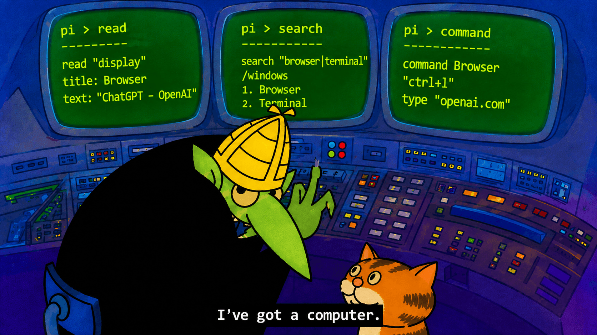

<p align="center">
  
</p>

<h1 align="center">Pi Agent Computer Use</h1>

<p align="center">Give your Pi agent a computer: see Windows apps, browsers and desktops, then click, type, draw and verify like a person would.</p>

<div align="center">

[](https://www.npmjs.com/package/pi-agent-computer-use)
[](https://www.npmjs.com/package/pi-agent-computer-use)
[](https://github.com/alexshpunt/pi-agent-computer-use/actions/workflows/ci.yml)
[](./LICENSE)

</div>

<div align="center">

[](https://pi.dev/packages/pi-agent-computer-use)
[](https://github.com/alexshpunt/pi-agent-ide)
[](#platforms)

</div>

Ask your agent to do something on your computer. For example: “Open Paint and draw a house”, “Fill in this form in my browser”, or “Check what the settings window says”. The agent finds the window, reads its controls and screenshot, acts, and reads again to check the result.

## Summary

Pi Agent Computer Use gives the [Pi coding agent](https://pi.dev/) one window-first interface for every app, browsers included. The agent discovers a window, reads its native accessibility tree and screenshot, and then types, clicks, drags or runs a browser action. Every input is grounded in the latest observation, and every result says what was delivered and what is still unknown.

| Work                                   | How                                                                         |
| -------------------------------------- | --------------------------------------------------------------------------- |
| Find windows, apps and displays        | Search or Read `computer:machine/local/windows`, `/apps` and `/displays`     |
| See a window                           | Read `computer:window/...` for its UI tree, short element hints and a screenshot |
| Act on what it saw                     | Write text or Insert one JSON action into the returned observation          |
| Work in web pages                      | Playwright snapshots and actions in browsers it opens or attaches to        |
| Check the result                       | `wait_for`, `verify`, change lists and fresh Reads                          |
| Work away from your desktop            | Windows Sandbox, isolated agent sessions and other machines over SSH        |

Desktop control is backed by [Cua Driver](https://github.com/trycua/cua), and web pages by [Playwright](https://playwright.dev/).

### Works with Pi Agent IDE, or on its own

With [Pi Agent IDE](https://github.com/alexshpunt/pi-agent-ide) installed, computer use plugs into its ordinary `read`, `search`, `write` and `insert` tools. The agent uses the same tools for files and for windows, and computer results render in the IDE's tool panels.

Without Pi Agent IDE, it adds its own `computer_read`, `computer_search`, `computer_write` and `computer_insert` tools. They stay out of the tool list until the agent needs them: the agent finds them with `tool_search` and then calls them directly. Both modes use the same addresses, commands and results, and both work from Codemode scripts. Each Pi session picks the mode on its own; nothing needs configuring.

### Built for YOLO, with Safe mode when you need it

Computer use is designed for an agent you trust with your desktop. In the default YOLO mode, the agent can read and operate any window you ask it to, read whole displays, attach to browsers that are already running and start programs by path. That is where it is most useful.

When you want limits, switch with `/computer-mode safe`. Safe mode lets the agent see and touch only the windows it opened itself, refuses display reads and refuses running arbitrary programs. Neither mode is OS isolation; for that, use a sandbox or an isolated session (below).

### See structure, not only pixels

A window Read returns the app's native UI tree from Windows UI Automation: roles, names, values, enabled state and bounds, with a short hint such as `1:a` on each element. Hints are drawn on the screenshot too, so the agent can point at a button by its hint instead of guessing coordinates.

- Search an observation's UI tree without capturing again.
- Inspect, scope or highlight one element, or read its full text.
- Choose `image`, `ui` or `full` reads to skip what is not needed.
- Use `changes` to see only what changed since the last read.
- Add `ocr` for text in canvases and games, or `regions` for icons and text areas detected by Cua perception.
- Zoom into a region of the latest overview, or crop one element at full resolution.
- Capture a short `sequence` of frames to watch an animation or progress bar, then pick the frames that matter.
- Read a window's `state` to see whether it is hung and how much memory its process uses.

### Act like a person, with real input

Input goes through the same window the agent observed:

- type literal text, press keys and chords, hold several keys at once;
- click, double-click, right-click, hover, scroll by wheel detents;
- drag straight lines or continuous brush strokes through many points;
- run a timeline of timed key, button, mouse and pen events, including raw relative mouse motion for pointer-locked apps and pen pressure and tilt;
- run up to 2000 known keyboard, click and stroke steps in one call, so a whole drawing fits in one action;
- invoke, select or set values through UI Automation, and open menu items by their labels.

Input starts in the background where Windows allows it, so your own pointer and focus stay where they are. Foreground input is an explicit second step, and it pauses whenever you touch the keyboard or mouse yourself.

### Know what actually happened

Every action returns a receipt: `delivered`, `refused` (nothing was sent) or `unknown` (it may have reached the app). The agent never replays an uncertain action blindly. Add `"expect"` to an action to check its postcondition, or `"successor":true` to get a compact list of what changed. `wait_for` and `verify` check UI conditions, and `batch` runs a short chain that stops at the first failure. In Codemode these receipts are plain objects, so scripts branch on `outcome` without parsing text.

### Use browsers and apps built on them

Web pages run through Playwright, with aria snapshots, element refs, locator actions and Playwright's own waiting. The agent can:

- open its own Chrome, Edge or Firefox with a disposable profile, or with a persistent agent profile for sites that need a login;
- attach to a Chrome or Edge that is already running, including your own profile when you allow it;
- attach to browsers inside Electron, CEF and WebView2 apps, and to VS Code's integrated browser through the included Pi Browser Bridge;
- switch tabs, answer JavaScript dialogs, upload and download files, run page code and read the console and network log.

The browser's own toolbar, tabs and system dialogs stay ordinary windows, so the agent can still use native input there.

### Work without touching your desktop

- **Windows Sandbox:** a disposable Windows with its own driver. Share only the folders you choose.
- **Isolated agent sessions:** a separate Windows session on the same machine with its own desktop, clipboard and input. Several agents can work at once, each with foreground input, without disturbing you.
- **Owned browsers:** disposable profiles that are deleted when the session closes.
- **Other machines:** operate another Windows machine with WSL over SSH, using the same addresses. No ports are opened.

### Move files, media and text in and out

Each session has its own folder on the controlled machine for files an app opens or saves. In YOLO mode the agent can also read and write the clipboard, record the screen to video, and record what the machine plays with an optional transcript.

### Check images with a local classifier

`computer_classify` evaluates one visual condition on an image with a small local model (TinyCLIP). It is useful in fast reaction loops, for example in games, where calling the main model for every frame is too slow.

### Watch what the agent sees

A private debug viewer (`/computer-debug`) shows the images the agent actually received, the action trace and capture settings. On Windows, an optional overlay briefly outlines the windows and targets the agent is working on, without stealing focus.

## Platforms

Computer use is qualified on **Windows 11 x64 controlled from Pi running in WSL**, on the same machine or on another one over SSH. Linux and macOS are not supported: window control there is not verified, so no runtime ships for them and computer use refuses with a clear message. Some features have their own requirements, for example Windows Sandbox needs a Windows edition that includes it, and isolated sessions need Windows 11 24H2 or newer.

Pi Agent Computer Use is experimental and under active development. Interfaces and behavior may change.

## Installation

Install [Pi](https://pi.dev/) in WSL first, then install the package:

```bash
pi install npm:pi-agent-computer-use
```

Or install it directly from GitHub:

```bash
pi install git:github.com/alexshpunt/pi-agent-computer-use
```

To try it for one session without changing your settings:

```bash
pi -e npm:pi-agent-computer-use
```

The package carries the native Cua Driver runtime for Windows; nothing else needs downloading. An installation from GitHub downloads the same pinned runtime once on first use. For the shared Read/Search/Write/Insert tools, also install [Pi Agent IDE](https://github.com/alexshpunt/pi-agent-ide):

```bash
pi install npm:pi-agent-ide
```

Pi packages run with your full system permissions, and this one controls your desktop. Review it before installing.

Some features need one-time setup on the Windows side, such as Firefox for Playwright, Cua perception for `regions`, MXC for isolated sessions or the VS Code bridge. See [the resource guide](docs/computer-resources.md) for each one.

## Commands

| Command                       | Effect                                                |
| ----------------------------- | ----------------------------------------------------- |
| `/computer-mode safe\|yolo`   | Switch between Safe and YOLO for this session          |
| `/computer-debug on\|off`     | Start or stop the private vision debug viewer          |

## Feedback and contributions

Computer use is developed through daily use on real tasks, but I can only test the machines, apps and workflows available to me. If something breaks or does not fit your workflow, please [open an issue](https://github.com/alexshpunt/pi-agent-computer-use/issues) or start a [discussion](https://github.com/alexshpunt/pi-agent-computer-use/discussions). Bug reports, ideas, questions and pull requests are welcome.

## Documentation

| Document                                                  | Contents                                                              |
| --------------------------------------------------------- | --------------------------------------------------------------------- |
| [Computer resources](docs/computer-resources.md)          | Addresses, views, commands, browsers, sandboxes, sessions, machines   |
| [Operating skill](.pi/skills/computer-use/SKILL.md)       | How the agent observes, plans, acts and verifies                      |
| [Complete input](docs/complete-input.md)                  | Keys, pointer, drags, sequences and their limits                      |
| [Semantic actions](docs/semantic-actions.md)              | UI Automation invoke, select and set value                            |
| [UI resources and hints](docs/ui-resources.md)            | The native UI tree, hints and local UI operations                     |
| [Window zoom and display detail](docs/native-detail.md)   | Readonly detail from the latest overview                              |
| [Temporal capture](docs/temporal-capture.md)              | Frame sequences and their timing                                      |
| [Selected displays](docs/selected-displays.md)            | Monitor discovery and display reads                                   |
| [Image guides](docs/image-guides.md)                      | Coordinate grid and last-action marks                                 |
| [Visual classifier](docs/visual-classifier.md)            | `computer_classify` setup and use                                     |
| [Vision debug viewer](docs/vision-debug.md)               | What the agent saw and the capture controls                           |
| [Bundled runtime](docs/bundled-runtime.md)                | Native runtime packages and platform boundaries                       |

## License

[MIT](./LICENSE)
