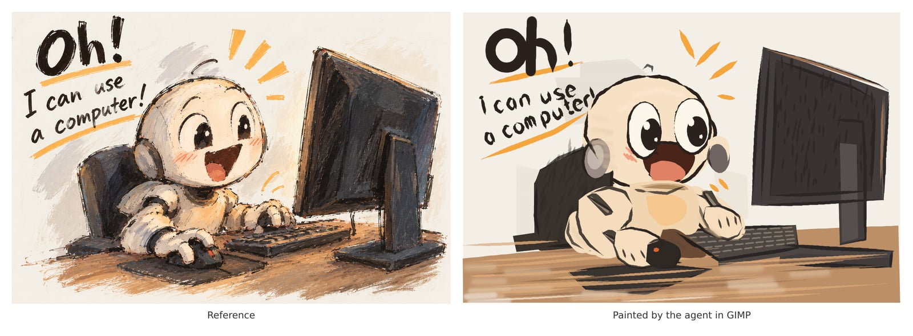
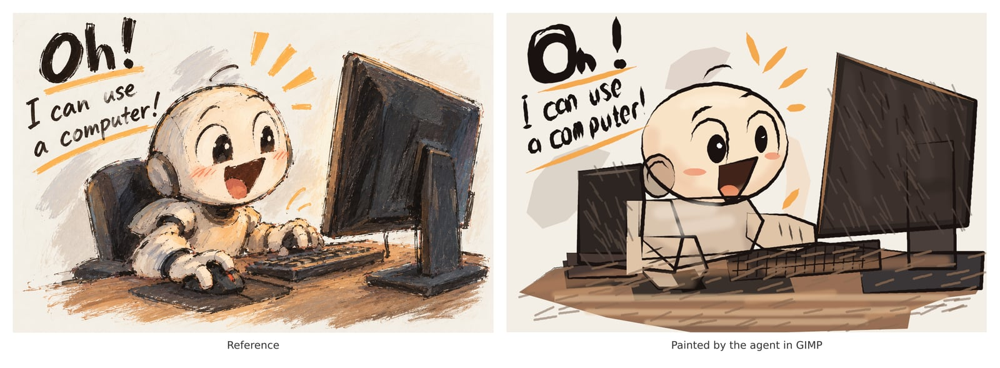
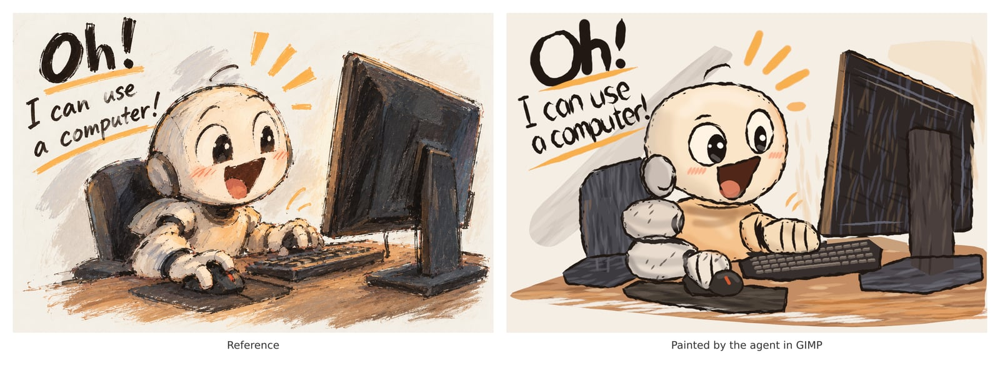
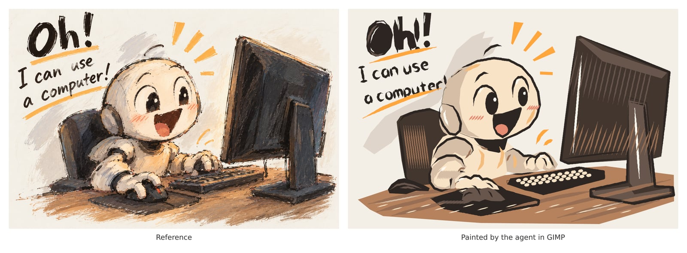

# GIMP painting gallery

Each run gave a Pi agent the same [reference picture](../../../assets/draw_task.png) and an empty canvas in GIMP, with the same [prompt](../prompt.md) and [painting skill](../skill/SKILL.md). [The demo guide](../README.md) explains how a run is made and how to add one.

Cost is the model cost Pi reported. Time is from the agent's start to its last answer.

## deepseek-flash-2026-11-01

**deepseek/deepseek-flash** · 2026-11-01 · 82 min · 105 turns · $0.34 · thinking high · 2790 tool calls

https://github.com/user-attachments/assets/e44e002f-c4a5-4030-ab76-fdc73d2765b5

## claude-haiku-5-5-2026-11-02

**anthropic/claude-haiku-5-5** · 2026-11-02 · 27 min · 40 turns · $0.33 · thinking high · 895 tool calls

The time-lapse of this run isn't uploaded yet.

## claude-opus-5-5-2026-11-02

**anthropic/claude-opus-5-5** · 2026-11-02 · 78 min · 99 turns · $5.04 · thinking high · 2232 tool calls

https://github.com/user-attachments/assets/e272a1aa-bb8b-44af-964c-752c42a0bfa7

## gpt-6.1-terra-2026-11-02

**openai-codex/gpt-6.1-terra** · 2026-11-02 · 14 min · 44 turns · $0.25 · thinking high · 552 tool calls

https://github.com/user-attachments/assets/564263b1-ed17-42c3-919e-c76fa06d5fb8
