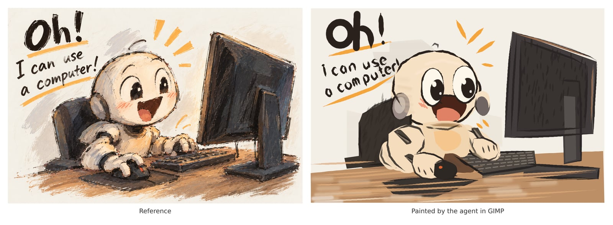

# GIMP painting gallery

Each run gave a Pi agent the same [reference picture](../../../assets/draw_task.png) and an empty canvas in GIMP, with the same [prompt](../prompt.md) and [painting skill](../skill/SKILL.md). [The demo guide](../README.md) explains how a run is made and how to add one.

Cost is the model cost Pi reported. Time is from the agent's start to its last answer.

## deepseek-flash-2026-11-01

**deepseek/deepseek-flash** · 2026-11-01 · 82 min · 105 turns · $0.34 · thinking high · 2790 tool calls

https://github.com/user-attachments/assets/e44e002f-c4a5-4030-ab76-fdc73d2765b5
