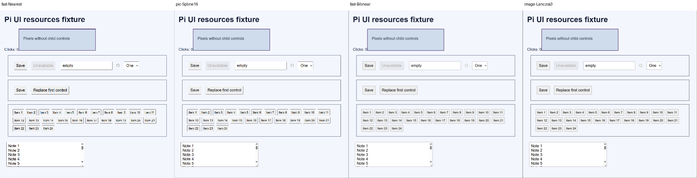

# Standalone screenshot resize benchmark

## Result

On this screenshot, **pic-scale Spline16 was the fastest output I would keep for readable UI: 0.70–0.85 ms**. It is about 22–26 times faster than `image` Lanczos3 in these runs. It still has jagged edges; this is a minimum-readable choice, not the best-looking one.

`fast_image_resize` Bilinear is a smoother alternative at 0.94–1.00 ms. If we want sharp small text without the current library's resize cost, SIMD Lanczos3 takes about 1.74–2.14 ms across the two libraries.

Nearest wins on raw speed, but I would not choose it for small UI labels. The fastest Nearest implementation changed between runs; the difference is too small to call one library the clear winner.

**Nothing was adopted into the extension or native Driver.** These are standalone WSL CPU measurements, not a promised reduction in whole-tool latency.

## Measurements

One native screenshot of a newly created synthetic UI fixture, 1237×1327 pixels, resized to 466×500. No personal windows or game frames were used. Host: AMD Ryzen 9 5900HS, x86-64 WSL2, Rust 1.97.1 release build, AVX2/SSE4.1 available. CPU affinity was not pinned; other machine activity was not controlled.

| Method | Run 1 median / p95, ms | Run 2 median / p95, ms |
| --- | ---: | ---: |
| fast Nearest | 0.420 / 0.713 | 0.392 / 0.441 |
| pic Nearest | 0.441 / 0.826 | 0.374 / 0.552 |
| pic Spline16 | 0.853 / 1.192 | 0.697 / 0.963 |
| fast Bilinear | 1.002 / 1.705 | 0.938 / 1.307 |
| pic Lanczos3 | 1.968 / 2.369 | 1.736 / 1.887 |
| fast Lanczos3 | 2.142 / 3.107 | 1.967 / 2.138 |
| image Triangle | 10.593 / 13.663 | 9.476 / 10.660 |
| image Lanczos3 | 18.999 / 21.702 | 17.817 / 19.767 |

[All 66 methods in both runs](../evidence/resize-benchmark/run.json). Each run used three warmups and 40 samples per method, with rotating order. All 66 output PNGs were byte-identical between runs.

The timer covers resize, destination allocation, coefficients and scratch allocation. Every call starts without a cached plan or reusable scratch buffers. It excludes capture, PNG decode/encode, file I/O and final output destruction. Source pixels were decoded once, fully opaque RGBA, without gamma conversion or alpha premultiplication. Threading features were disabled. This compares real library implementations, not just abstract kernels.

## Visual review

I viewed all 66 outputs in six contact sheets at their actual 466×500 size, then inspected the fastest candidates separately. I checked the title, Save/Replace labels, empty input, dropdown, checkbox, item numbers, notes and thin control boundaries.

- **Nearest:** layout and large text remain clear, but small glyphs lose strokes and thin borders become uneven. Rejected for fine UI reading.
- **Spline16:** control labels and item numbers remain readable. Some edges and text strokes look jagged, but it passes the minimum-readability check on this image.
- **Bilinear:** smoother borders and text, with mild softness. A good speed/appearance compromise.
- **Lanczos3:** clean, sharp small text and boundaries. More work than Bilinear, but both SIMD implementations are far faster than `image` here.
- **pic Box/Area:** noticeably blurred small labels; not preferred for this screenshot.
- Most remaining filters produce understandable controls but do not beat Spline16 on speed. Some soft filters blur the fine text; wider kernels cost more without an obvious benefit on this fixture.

The comparison below crops off the browser toolbar, but does not resize the outputs again:

This is a visual judgement on one static UI image, not an OCR score, model accuracy test, photo-quality test or game benchmark. It does not establish the best filter for all inputs.

## Licenses

The exact downloaded versions declare:

- `image` 0.25.10: **MIT OR Apache-2.0**.
- `fast_image_resize` 6.1.0: **MIT OR Apache-2.0**.
- `pic-scale` 0.7.12: **BSD-3-Clause OR Apache-2.0**.

The primary MIT/BSD texts permit open and commercial use with notice/disclaimer requirements; BSD also prohibits unapproved endorsement. All 35 locked registry-package manifests were checked. They offer permissive license choices; `unicode-ident` additionally requires Unicode-3.0 notices, and `zlib-rs` has Zlib attribution/source restrictions. No research-only restriction was found. This is not a complete binary redistribution notice bundle or a legal opinion.

Upstream sources: [image](https://github.com/image-rs/image), [fast_image_resize](https://github.com/Cykooz/fast_image_resize), [pic-scale](https://github.com/awxkee/pic-scale). The standalone manifest and lock file pin the versions used.

## Reproduce and scope

[Runner and instructions](../../scripts/resize-bench/README.md). A meaningful aspect-ratio/no-upscale regression test, two actual benchmark runs and formatting check passed. Clippy was unavailable in the existing toolchain and was not installed. No extension tests were run for this standalone change.

The owned browser fixture was closed and its temporary profile removed, with both cleanup receipts confirmed. Application input count was zero. Private source/full output images and build files were removed after this report and the redacted comparison were saved. Model assets and other agents' work were left alone.

A later integration experiment needs its own approval and Windows end-to-end checks. In particular, saving 17–18 ms of resize work would not eliminate capture, transport, classifier or click latency.
